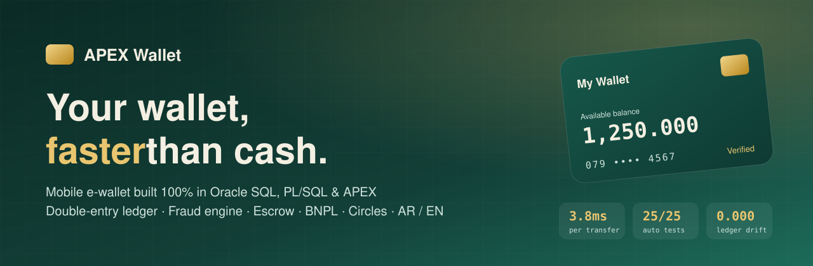
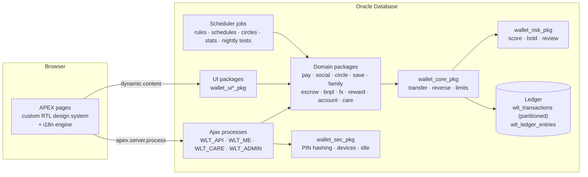
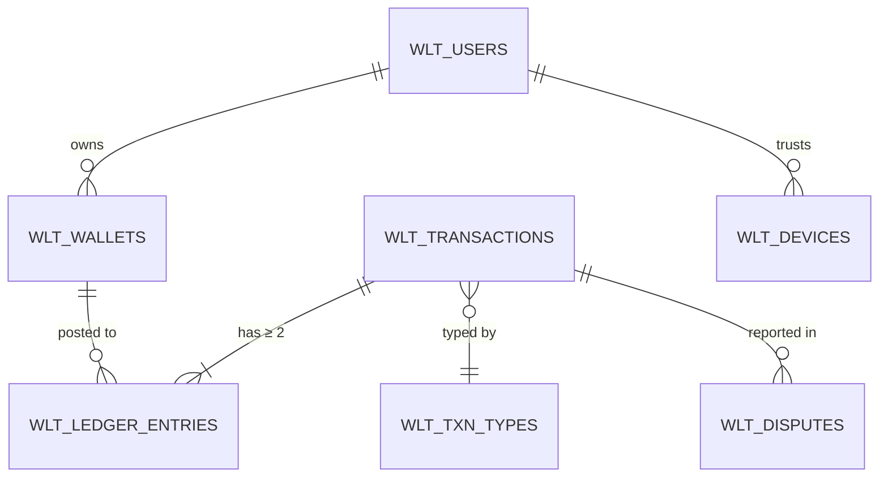

<p align="center">
  
</p>

<p align="center">
  
  
  
  
  
</p>

<p align="center">
  <b>A complete mobile e-wallet — transfers, merchant QR, bills, savings jars, family wallets, escrow, buy-now-pay-later, multi-currency, fraud detection and an admin console — built entirely in the Oracle database with SQL, PL/SQL and Oracle APEX.</b><br>
  <sub>No JavaScript framework, no external backend. Every dinar moves through a double-entry ledger that can be proven balanced at any moment.</sub>
</p>

<p align="center">
  <a href="#-highlights">Highlights</a> ·
  <a href="#-features">Features</a> ·
  <a href="#-architecture">Architecture</a> ·
  <a href="#-the-ledger">Ledger</a> ·
  <a href="#-security">Security</a> ·
  <a href="#-performance">Performance</a> ·
  <a href="#-install">Install</a> ·
  <a href="#-بالعربي">بالعربي</a>
</p>

---

## ✨ Highlights

| | |
|---|---|
| 🧾 **Double-entry ledger** | Every transaction writes balanced debit/credit entries with the running `balance_after`. Three invariant checks prove the books balance per currency. |
| ⚡ **Fast** | **3.8 ms** per transfer including fraud scoring, limits, triggers and commit (~265 transfers/s on one session). 1,000 concurrent transfers in opposite directions: **0 deadlocks, 0 failures**. |
| 🛡️ **Fraud engine** | Real-time risk score on every transfer and cash-out; high scores are held for admin review with the money frozen, not lost. |
| 🔐 **Bank-style security** | Stretched + peppered PIN hashing, new-device verification by SMS code, 5-attempt lockout, idle auto-logout, full audit log. |
| 🧪 **Self-testing** | 25 automated tests run every night and on demand from the admin console. |
| 🌍 **Arabic & English** | Native RTL design, with a live English translation layer (1,400+ strings in a table, editable without code). |

## 📱 Features

<table>
<tr><th>👤 Customers</th><th>🏪 Merchants &amp; Agents</th><th>🧑‍💼 Admin</th></tr>
<tr valign="top"><td>

- Instant P2P transfers by phone number
- Pay merchants by QR or one-time pay code
- Bills &amp; mobile top-ups
- Request money (link + QR) &amp; split bills
- Scheduled / recurring transfers
- **Savings jars** with goals, lock dates &amp; smart rules (round-ups, % of income, nightly sweep, spending alerts)
- **Circles (Jam'iya)**: rotating savings with escrowed installments and random turn order
- **Eidiya**: gift envelopes split equally or by luck
- **Escrow** purchases with delivery confirmation &amp; disputes
- **Buy now, pay later** in 3–4 interest-free installments
- Multi-currency wallets (JOD / USD / EUR)
- Points &amp; cashback tiers
- Spending insights with charts
- Full history with search, filters &amp; CSV export
- Monthly statement (print / PDF)
- Report a problem on any transaction

</td><td>

- Static merchant QR &amp; dynamic amount QR
- Collect by customer pay code
- Agent cash-in / cash-out with one-time codes
- Sales dashboard

**👨‍👩‍👧 Family**
- Child wallets with daily allowance
- Block store categories
- Pause / resume spending
- Weekly allowance automation

</td><td>

- Live KPIs &amp; 14-day volume chart
- Fraud review queue (approve / reject &amp; freeze)
- Reverse any eligible transaction with reason
- Customer complaints queue
- KYC upgrade requests with ID &amp; selfie review
- User search, suspend, tier changes
- FX rate management
- **One-click test suite** + nightly run

</td></tr>
</table>

## 🏗 Architecture



Every screen is a PL/SQL function that returns HTML, and every action is an Ajax process that returns JSON. The page never touches a table directly; it goes through the domain packages, which all go through `wallet_core_pkg.transfer`, the only code allowed to move money.

## 📒 The ledger



- **Immutable**: entries are never updated or deleted; mistakes are fixed with a reversing transaction.
- **Idempotent**: every request carries a key; replaying it returns the original reference instead of charging twice.
- **Holds, not debits**: escrow, risk review and BNPL use `held_amount`, so frozen money stays visible but unspendable.
- **Provably balanced**: `SUM(balance)` per currency is always `0`, `wlt_v_check_unbalanced_txns` and `wlt_v_check_wallet_drift` are always empty — checked nightly by the test suite.
- **Partitioned** monthly by `created_at` with local indexes, plus a materialized view for admin statistics.

## 🔐 Security

| Layer | What it does |
|---|---|
| PIN storage | Per-user salt + secret pepper kept outside the users table + 30,000 SHA-256 rounds. Old hashes were wrapped in place, so no user had to reset. |
| New device | First login on any browser needs a one-time SMS code; the user is notified and can remove devices from *My account*. |
| Lockout | 5 wrong PINs lock the account for 15 minutes; OTPs expire in 5 minutes with attempt limits and resend throttling. |
| Sessions | Auto logout after 5 idle minutes (shared across tabs) plus a server-side idle limit. |
| Fraud | Risk score on amount anomalies, new recipients, velocity, unusual hours and account age; holds ≥ 70, watches ≥ 40. |
| Audit | Logins, PIN changes, reversals, KYC decisions, disputes and device changes are all written to `wlt_audit_log`. |

## 🚀 Performance

| Test | Result |
|---|---|
| 1,000 sequential transfers | **3.77 ms** each (≈ 265 / s) incl. fraud check, limits, triggers, commit |
| 4 parallel jobs × 250 transfers, opposite directions on the same two wallets | 7.1 s total, **0 deadlocks, 0 failures**, balances back to the exact starting amounts |
| Monthly statement | Read straight from `balance_after` — no re-computation |

## 🧪 Tests

`wallet_test_pkg.run_all` runs 25 checks: ledger balance per currency, unbalanced transactions, wallet drift, invalid objects, scheduler errors, exact transfer amounts, reversal, idempotency, rejection of bad amounts, PIN hashing, OTP hashing, statement maths, the full complaint lifecycle, reversal protection, app structure and stats freshness. It runs nightly at 03:17 (Amman) and from **Admin → Tests**.

## 📦 Install

> Requires Oracle Database 23ai / 26ai with Oracle APEX 26.x (works on the free [oracleapex.com](https://oracleapex.com) workspace).

1. Create an APEX application and note its ID and workspace ID.
2. Run the scripts in `database/` **in numeric order** (`01_foundation.sql` → `12d_i18n.sql`; `*_tests.sql` are optional) from **SQL Workshop → SQL Scripts**.
3. Scripts that create pages call `wwv_flow_imp` — update `p_default_workspace_id`, `p_default_application_id` and `p_default_owner` to yours first.
4. Run the test suite — expect 25/25:
   ```sql
   DECLARE n NUMBER; BEGIN n := wallet_test_pkg.run_all('SETUP'); END;
   SELECT passed, failed FROM wlt_test_runs ORDER BY run_id DESC FETCH FIRST 1 ROW ONLY;
   ```
5. Demo accounts use PIN `1234`. SMS runs in **DEMO** mode (the code is shown on screen) until you set `SMS_MODE = LIVE` and a provider credential.

`database/00_cleanup.sql` drops everything if you want to start over.

## 🗂 Project structure

Scripts are numbered in run order; each session adds a domain package (`NN_*.sql`) and its screens (`NNb_*.sql`).

| Files | What they build |
|---|---|
| `00_cleanup` | drops everything (start over) |
| `01_*` | tables, constraints, views, seed data |
| `02_*` | transfer engine, limits, fees, reversal + tests |
| `03_*` | design system, home, custom login |
| `04_*` | QR pay, bills, cash in/out, agents + tests |
| `05_*` | requests, split bills, schedules, notifications |
| `06_*` | circles, Eidiya, SMS outbox, OTP sign-up / reset |
| `07_*` | savings jars, smart rules, child wallets, pay codes |
| `08_*` | escrow, BNPL, FX, rewards |
| `09_*` | fraud engine, admin console, spending insights |
| `10_*` | partitioning, indexes, stats, stress tests |
| `11_extras` | history & search, account page, admin reversal, KYC |
| `12a–12d` | PIN hashing, devices, idle logout, disputes, statement, test suite, English UI |

## 🛣 Roadmap

- [ ] Real SMS provider (the outbox and `LIVE` mode are ready)
- [ ] Card top-up / bank withdrawal through a payment gateway
- [ ] Server-side PDF statements
- [ ] Native mobile wrapper (PWA)

---

## 🇯🇴 بالعربي

**محفظة إلكترونية كاملة** مبنية بالكامل داخل قاعدة بيانات Oracle باستخدام SQL و PL/SQL و Oracle APEX، بدون أي إطار JavaScript أو خادم خارجي.

- **تحويل فوري** برقم الهاتف، دفع للتجار بـ QR أو كود مؤقت، فواتير وشحن خطوط.
- **حصّالات ادخار** بأهداف وقواعد ذكية، و**جمعيات** بأقساط محفوظة بحساب ضمان، و**عيديات**.
- **مشتريات مضمونة** (Escrow)، و**اشترِ الآن وادفع لاحقاً** بدون فوائد، ومحافظ بعدة عملات.
- **محافظ للأبناء** بمصروف يومي وضوابط من ولي الأمر.
- **دفتر قيود مزدوج** لا يُعدّل، ويُثبت توازنه في أي لحظة.
- **كشف احتيال** لحظي، وتشفير قوي للرمز السري، وتحقق من الأجهزة الجديدة، وخروج تلقائي.
- **لوحة إدارة** فيها مراجعة العمليات المشبوهة، وعكس العمليات، وبلاغات العملاء، وطلبات التوثيق، و**فحص آلي** من 25 اختباراً يعمل كل ليلة.
- **واجهة عربية وإنجليزية**.

---

<p align="center">
  Built by <b>Mohammad Bataineh</b> · Oracle APEX developer<br>
  <a href="https://www.linkedin.com/in/mohammad-bataineh-apex/">LinkedIn</a>
</p>
